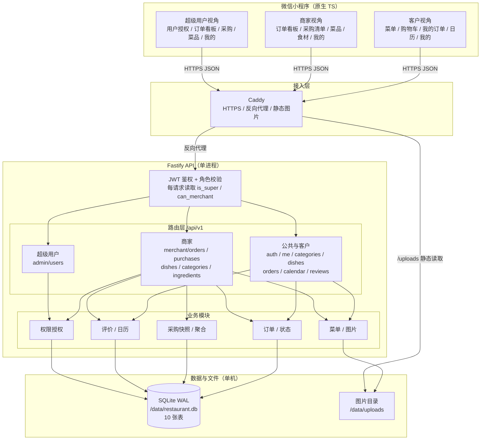
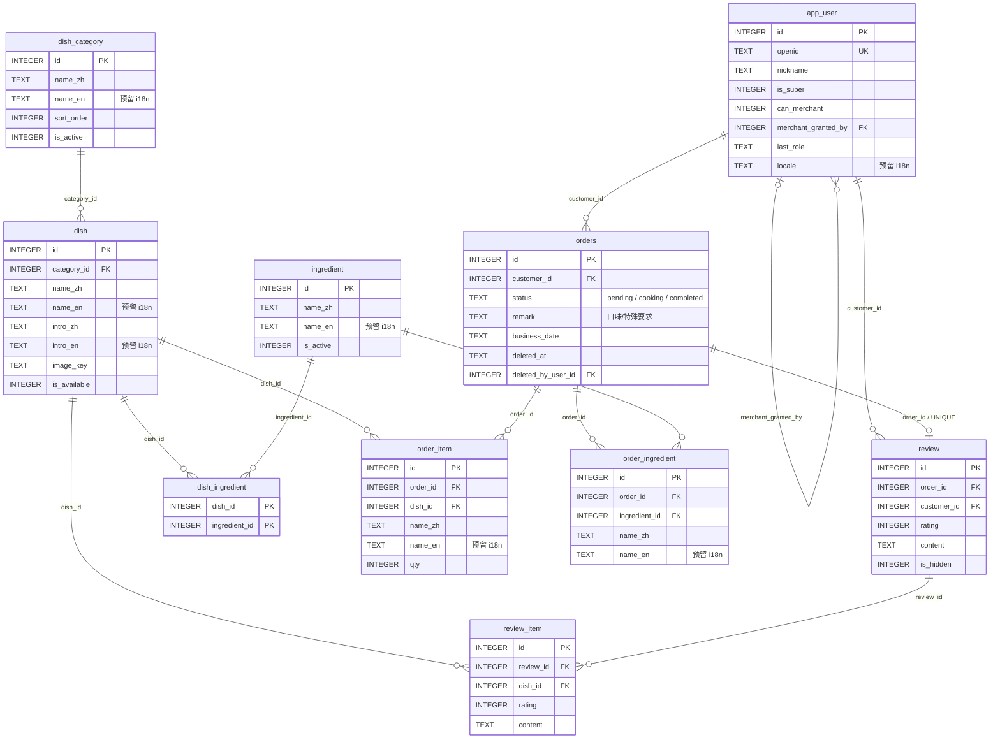
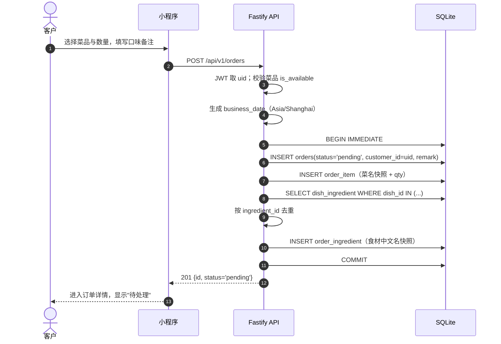
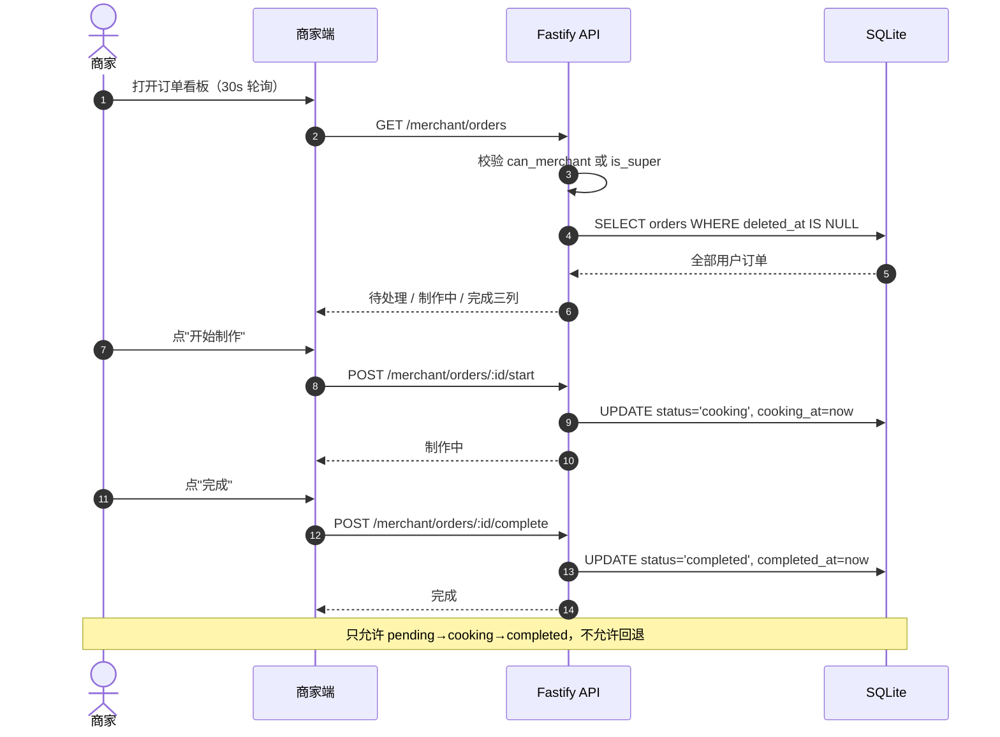
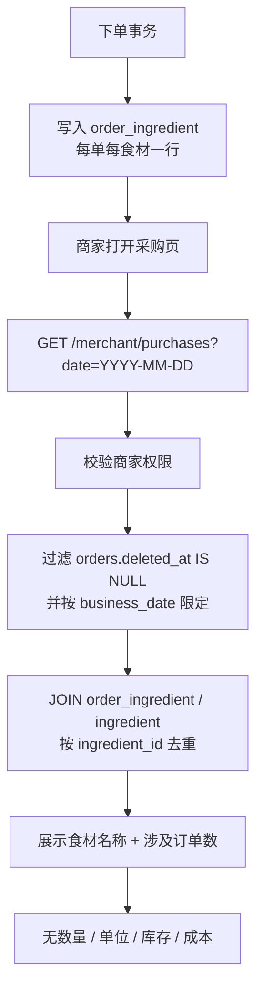
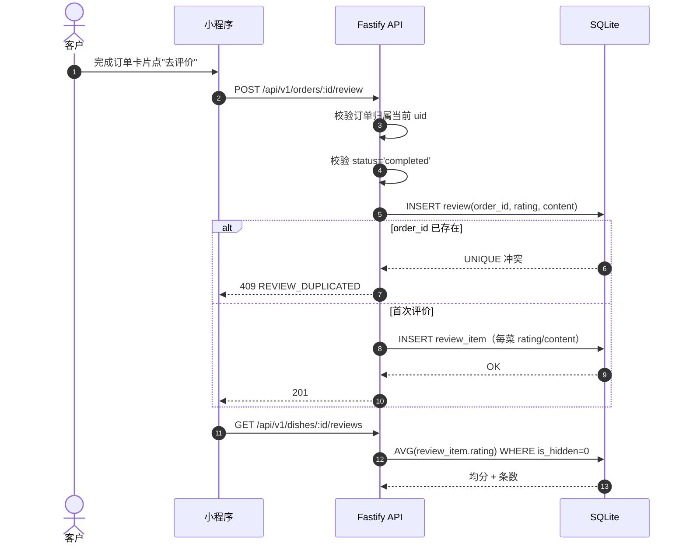
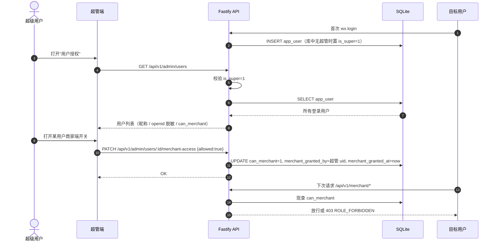
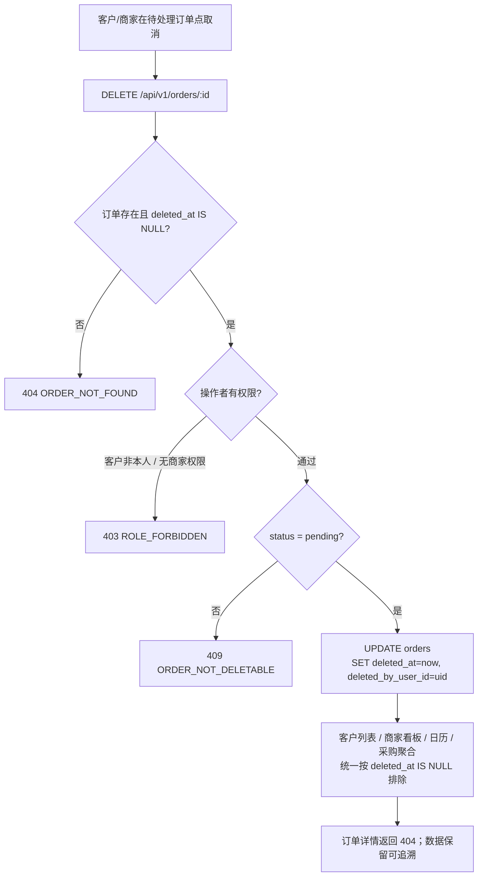

# 小张的餐厅 · 架构与数据模型

> 版本 v1.0 · 2026-11-07
> 对应 `docs/方案设计.md` v0.3。本文只做设计与图示，不包含业务代码。
> 本期范围：客户/商家/超级用户三视角、SQLite、图片本地存储；AI 推荐与中英文切换仅保留设计位置，不实现。

**本文包含**

- 总体架构图、数据 ER 图、6 张关键流程执行图（Mermaid，可直接在支持 Mermaid 的预览器中渲染）。
- 10 张表的字段级定义：类型、可空、默认值、主外键、索引与唯一约束。
- 可直接执行的 SQLite 建表与建索引语句。
- AI 推荐菜品、中英文切换的预留设计（本期不加接口、不加页面、不写入）。

## 1. 总体架构



**请求走向**

1. 小程序通过 HTTPS 调用 `/api/v1/*`，不直连数据库，也不持有任何存储密钥。
2. Caddy 终止 TLS 并反向代理到 Fastify；`/uploads/*` 由 Caddy 直接读本地文件。
3. Fastify 先做 JWT 鉴权，再按接口分组校验 `is_super` / `can_merchant`。角色不写进 JWT，撤销商家权限立即生效。
4. 业务模块只在服务端读写 SQLite；图片文件与数据库分离，数据库只存 `image_key`。
5. 单进程 + WAL，禁止多实例写同一个库；商家看板用 30s 轮询，不使用 WebSocket。

## 2. 数据模型

### 2.1 ER 图



> ER 图只列关键字段，完整字段见第 3 节；字段名带 "预留 i18n" 的列本期不读写。

### 2.2 关系口径

| 关系 | 基数 | 落库方式 | 说明 |
|---|---|---|---|
| 用户 → 订单 | 1:N | `orders.customer_id` | 客户订单隔离键；客户接口强制按当前 uid 过滤 |
| 用户 → 评价 | 1:N | `review.customer_id` | 评价人也必须是订单本人 |
| 用户 → 用户 | 0/1:N | `app_user.merchant_granted_by` | 记录最近一次授权人，自引用外键 |
| 分类 → 菜品 | 1:N | `dish.category_id` | 分类软删，不物理删除 |
| 菜品 ↔ 食材 | N:N | `dish_ingredient(dish_id, ingredient_id)` | 只表达"需要哪些食材"，无用量、无单位 |
| 订单 → 明细 | 1:N | `order_item.order_id` | 明细保存菜名快照，菜品改名不影响历史 |
| 订单 → 采购快照 | 1:N | `order_ingredient.order_id` | 每单每食材一行，按 `ingredient_id` 去重 |
| 订单 → 评价 | 1:0/1 | `review.order_id` + `UNIQUE` | 一单一评；仅完成订单可评 |
| 评价 → 菜品评分 | 1:N | `review_item.review_id` | 每个菜品一条，`(review_id, dish_id)` 唯一 |

**订单隔离**：`orders.customer_id` 是唯一隔离键。客户列表与详情由服务端注入当前 uid，客户端不能传 `customerId`；商家接口不按用户过滤。

**商家授权**：`app_user.can_merchant` 是商家端开关，`merchant_granted_by/at` 记录授权来源；只有 `is_super=1` 能调用授权接口，且鉴权时现查数据库。

**历史稳定**：`order_item.name_zh`、`order_ingredient.name_zh` 为下单快照；菜单改名、菜品下架均不影响历史订单和采购记录。

## 3. 表结构（字段级）

约定：

- `id` 使用 `INTEGER PRIMARY KEY`（SQLite rowid 别名），不额外 `AUTOINCREMENT`；业务数据只用软删，不复用 id。
- 时间字段用 TEXT 存 UTC ISO8601；`business_date` 存 `Asia/Shanghai` 的 `YYYY-MM-DD`。
- 布尔字段用 INTEGER 0/1，并加 `CHECK`。
- `name_en` / `intro_en` / `locale` 是 i18n 预留字段，本期不写入、不返回、不展示。
- `updated_at` 由服务端在写操作时更新，不建触发器。

### 3.1 `app_user`（登录用户与权限）

| 字段 | 类型 | 可空 | 默认值 | 约束 / 说明 |
|---|---|---|---|---|
| `id` | INTEGER | 否 | — | 主键 |
| `openid` | TEXT | 否 | — | 微信 openid，唯一 |
| `nickname` | TEXT | 是 | NULL | 用户昵称，可空 |
| `is_super` | INTEGER | 否 | 0 | 0/1；初始化逻辑写入，无接口可改 |
| `can_merchant` | INTEGER | 否 | 0 | 0/1；商家端访问开关 |
| `merchant_granted_by` | INTEGER | 是 | NULL | 外键 → `app_user.id`，授权人 |
| `merchant_granted_at` | TEXT | 是 | NULL | 最近一次授权时间 |
| `last_role` | TEXT | 否 | 'customer' | `customer` / `merchant` / `admin` |
| `locale` | TEXT | 否 | 'zh-CN' | `zh-CN` / `en-US`；**预留，本期不读写** |
| `created_at` | TEXT | 否 | `strftime(...)` | 首次登录时间 |
| `updated_at` | TEXT | 否 | `strftime(...)` | 服务端更新 |
| `last_login_at` | TEXT | 否 | `strftime(...)` | 最近登录时间 |

- 唯一约束：`UNIQUE(openid)`。
- 外键：`merchant_granted_by → app_user(id) ON DELETE SET NULL`。
- 索引：openid 唯一索引由约束自动创建，无额外索引。

### 3.2 `dish_category`（菜品分类）

| 字段 | 类型 | 可空 | 默认值 | 约束 / 说明 |
|---|---|---|---|---|
| `id` | INTEGER | 否 | — | 主键 |
| `name_zh` | TEXT | 否 | — | 中文分类名 |
| `name_en` | TEXT | 是 | NULL | **预留 i18n，本期不写入** |
| `sort_order` | INTEGER | 否 | 0 | 升序展示 |
| `is_active` | INTEGER | 否 | 1 | 0/1，软删 |
| `created_at` | TEXT | 否 | `strftime(...)` | |
| `updated_at` | TEXT | 否 | `strftime(...)` | |

- 索引：`(is_active, sort_order)`。

### 3.3 `dish`（菜品）

| 字段 | 类型 | 可空 | 默认值 | 约束 / 说明 |
|---|---|---|---|---|
| `id` | INTEGER | 否 | — | 主键 |
| `category_id` | INTEGER | 否 | — | 外键 → `dish_category.id` |
| `name_zh` | TEXT | 否 | — | 中文菜名 |
| `name_en` | TEXT | 是 | NULL | **预留 i18n，本期不写入** |
| `intro_zh` | TEXT | 是 | NULL | 中文简介 |
| `intro_en` | TEXT | 是 | NULL | **预留 i18n，本期不写入** |
| `image_key` | TEXT | 是 | NULL | 相对路径，如 `2026/11/uuid.jpg` |
| `is_available` | INTEGER | 否 | 1 | 0/1，上下架/售罄 |
| `sort_order` | INTEGER | 否 | 0 | 分类内排序 |
| `created_at` | TEXT | 否 | `strftime(...)` | |
| `updated_at` | TEXT | 否 | `strftime(...)` | |

- 外键：`category_id → dish_category(id) ON DELETE RESTRICT`。
- 索引：`(category_id, sort_order)`。
- 无价格、金额、成本字段。

### 3.4 `ingredient`（食材库）

| 字段 | 类型 | 可空 | 默认值 | 约束 / 说明 |
|---|---|---|---|---|
| `id` | INTEGER | 否 | — | 主键 |
| `name_zh` | TEXT | 否 | — | 中文食材名 |
| `name_en` | TEXT | 是 | NULL | **预留 i18n，本期不写入** |
| `is_active` | INTEGER | 否 | 1 | 0/1，软删 |
| `created_at` | TEXT | 否 | `strftime(...)` | |
| `updated_at` | TEXT | 否 | `strftime(...)` | |

- 索引：`(is_active)`。
- 无单位、无库存、无数量字段。

### 3.5 `dish_ingredient`（菜品食材清单）

| 字段 | 类型 | 可空 | 默认值 | 约束 / 说明 |
|---|---|---|---|---|
| `dish_id` | INTEGER | 否 | — | 主键之一，外键 → `dish.id` |
| `ingredient_id` | INTEGER | 否 | — | 主键之一，外键 → `ingredient.id` |

- 复合主键：`(dish_id, ingredient_id)`，天然去重。
- 外键：`dish_id → dish(id) ON DELETE CASCADE`；`ingredient_id → ingredient(id) ON DELETE CASCADE`。
- 索引：`(ingredient_id)`，用于反查"哪些菜用了该食材"。
- 只表达对应关系，无 `qty`、无 `unit`。

### 3.6 `orders`（订单）

| 字段 | 类型 | 可空 | 默认值 | 约束 / 说明 |
|---|---|---|---|---|
| `id` | INTEGER | 否 | — | 主键，页面展示 `#id` |
| `customer_id` | INTEGER | 否 | — | 外键 → `app_user.id`，订单隔离键 |
| `status` | TEXT | 否 | 'pending' | `pending` / `cooking` / `completed` |
| `remark` | TEXT | 是 | NULL | 仅口味/特殊要求，与取餐无关 |
| `business_date` | TEXT | 否 | — | `YYYY-MM-DD`（Asia/Shanghai） |
| `created_at` | TEXT | 否 | `strftime(...)` | 下单时间（UTC） |
| `cooking_at` | TEXT | 是 | NULL | 开始制作时间 |
| `completed_at` | TEXT | 是 | NULL | 完成时间 |
| `deleted_at` | TEXT | 是 | NULL | 软删除标记；有值即视为取消 |
| `deleted_by_user_id` | INTEGER | 是 | NULL | 外键 → `app_user.id`，取消操作人 |
| `updated_at` | TEXT | 否 | `strftime(...)` | |

- 检查约束：`status IN ('pending','cooking','completed')`；`deleted_by_user_id` 有值时必须 `deleted_at` 有值。
- 外键：`customer_id → app_user(id) ON DELETE RESTRICT`；`deleted_by_user_id → app_user(id) ON DELETE SET NULL`。
- 索引：`(customer_id, created_at DESC)`、`(business_date, status)`、`(status, created_at DESC)`。
- 无金额、无支付、无取餐/桌号字段。

### 3.7 `order_item`（订单明细）

| 字段 | 类型 | 可空 | 默认值 | 约束 / 说明 |
|---|---|---|---|---|
| `id` | INTEGER | 否 | — | 主键 |
| `order_id` | INTEGER | 否 | — | 外键 → `orders.id` |
| `dish_id` | INTEGER | 否 | — | 外键 → `dish.id`，用于评价关联 |
| `name_zh` | TEXT | 否 | — | 下单时菜名快照 |
| `name_en` | TEXT | 是 | NULL | 下单时英文名快照；**预留 i18n** |
| `qty` | INTEGER | 否 | — | 数量，`CHECK (qty > 0)` |

- 外键：`order_id → orders(id) ON DELETE CASCADE`；`dish_id → dish(id) ON DELETE RESTRICT`。
- 索引：`(order_id)`、`(dish_id)`。
- 无单价、无小计。

### 3.8 `order_ingredient`（订单食材快照 / 采购详情）

| 字段 | 类型 | 可空 | 默认值 | 约束 / 说明 |
|---|---|---|---|---|
| `id` | INTEGER | 否 | — | 主键 |
| `order_id` | INTEGER | 否 | — | 外键 → `orders.id` |
| `ingredient_id` | INTEGER | 否 | — | 外键 → `ingredient.id` |
| `name_zh` | TEXT | 否 | — | 下单时食材中文名快照 |
| `name_en` | TEXT | 是 | NULL | 下单时英文名快照；**预留 i18n** |
| `created_at` | TEXT | 否 | `strftime(...)` | |

- 唯一约束：`UNIQUE(order_id, ingredient_id)`，同一订单同一食材只一行。
- 外键：`order_id → orders(id) ON DELETE CASCADE`；`ingredient_id → ingredient(id) ON DELETE RESTRICT`。
- 索引：`(ingredient_id)`；`UNIQUE(order_id, ingredient_id)` 自带订单前缀索引。
- 无数量、无单位、无库存、无成本。

### 3.9 `review`（整单评价）

| 字段 | 类型 | 可空 | 默认值 | 约束 / 说明 |
|---|---|---|---|---|
| `id` | INTEGER | 否 | — | 主键 |
| `order_id` | INTEGER | 否 | — | 外键 → `orders.id`，唯一 |
| `customer_id` | INTEGER | 否 | — | 外键 → `app_user.id` |
| `rating` | INTEGER | 否 | — | 整单 1–5 星 |
| `content` | TEXT | 是 | NULL | 整单文字评论 |
| `is_hidden` | INTEGER | 否 | 0 | 0/1，商家隐藏内容 |
| `created_at` | TEXT | 否 | `strftime(...)` | |

- 唯一约束：`UNIQUE(order_id)`，一单一评。
- 外键：`order_id → orders(id) ON DELETE CASCADE`；`customer_id → app_user(id) ON DELETE RESTRICT`。
- 索引：`(customer_id, created_at DESC)`。

### 3.10 `review_item`（菜品评分与短评）

| 字段 | 类型 | 可空 | 默认值 | 约束 / 说明 |
|---|---|---|---|---|
| `id` | INTEGER | 否 | — | 主键 |
| `review_id` | INTEGER | 否 | — | 外键 → `review.id` |
| `dish_id` | INTEGER | 否 | — | 外键 → `dish.id` |
| `rating` | INTEGER | 否 | — | 菜品 1–5 星 |
| `content` | TEXT | 是 | NULL | 菜品短评 |
| `created_at` | TEXT | 否 | `strftime(...)` | |

- 唯一约束：`UNIQUE(review_id, dish_id)`，同一次评价同一道菜只一条。
- 外键：`review_id → review(id) ON DELETE CASCADE`；`dish_id → dish(id) ON DELETE RESTRICT`。
- 索引：`(dish_id)`，用于菜品均分聚合。

## 4. 完整 SQLite DDL

```sql
-- 连接级设置，每条连接都要执行
PRAGMA foreign_keys = ON;
PRAGMA journal_mode = WAL;
PRAGMA synchronous = NORMAL;
PRAGMA busy_timeout = 5000;

-- 1. 登录用户与权限
CREATE TABLE app_user (
  id                  INTEGER PRIMARY KEY,
  openid              TEXT    NOT NULL,
  nickname            TEXT,
  is_super            INTEGER NOT NULL DEFAULT 0 CHECK (is_super IN (0, 1)),
  can_merchant        INTEGER NOT NULL DEFAULT 0 CHECK (can_merchant IN (0, 1)),
  merchant_granted_by  INTEGER REFERENCES app_user(id) ON DELETE SET NULL,
  merchant_granted_at TEXT,
  last_role           TEXT    NOT NULL DEFAULT 'customer'
                              CHECK (last_role IN ('customer', 'merchant', 'admin')),
  locale              TEXT    NOT NULL DEFAULT 'zh-CN'
                              CHECK (locale IN ('zh-CN', 'en-US')), -- 预留 i18n
  created_at          TEXT    NOT NULL DEFAULT (strftime('%Y-%m-%dT%H:%M:%fZ', 'now')),
  updated_at          TEXT    NOT NULL DEFAULT (strftime('%Y-%m-%dT%H:%M:%fZ', 'now')),
  last_login_at       TEXT    NOT NULL DEFAULT (strftime('%Y-%m-%dT%H:%M:%fZ', 'now')),
  UNIQUE (openid)
);

-- 2. 菜品分类
CREATE TABLE dish_category (
  id          INTEGER PRIMARY KEY,
  name_zh     TEXT    NOT NULL,
  name_en     TEXT,                                      -- 预留 i18n
  sort_order  INTEGER NOT NULL DEFAULT 0,
  is_active   INTEGER NOT NULL DEFAULT 1 CHECK (is_active IN (0, 1)),
  created_at  TEXT    NOT NULL DEFAULT (strftime('%Y-%m-%dT%H:%M:%fZ', 'now')),
  updated_at  TEXT    NOT NULL DEFAULT (strftime('%Y-%m-%dT%H:%M:%fZ', 'now'))
);

-- 3. 菜品（无价格、无成本）
CREATE TABLE dish (
  id           INTEGER PRIMARY KEY,
  category_id  INTEGER NOT NULL REFERENCES dish_category(id) ON DELETE RESTRICT,
  name_zh      TEXT    NOT NULL,
  name_en      TEXT,                                      -- 预留 i18n
  intro_zh     TEXT,
  intro_en     TEXT,                                      -- 预留 i18n
  image_key    TEXT,
  is_available INTEGER NOT NULL DEFAULT 1 CHECK (is_available IN (0, 1)),
  sort_order   INTEGER NOT NULL DEFAULT 0,
  created_at   TEXT    NOT NULL DEFAULT (strftime('%Y-%m-%dT%H:%M:%fZ', 'now')),
  updated_at   TEXT    NOT NULL DEFAULT (strftime('%Y-%m-%dT%H:%M:%fZ', 'now'))
);

-- 4. 食材库（无单位、无库存）
CREATE TABLE ingredient (
  id          INTEGER PRIMARY KEY,
  name_zh     TEXT    NOT NULL,
  name_en     TEXT,                                      -- 预留 i18n
  is_active   INTEGER NOT NULL DEFAULT 1 CHECK (is_active IN (0, 1)),
  created_at  TEXT    NOT NULL DEFAULT (strftime('%Y-%m-%dT%H:%M:%fZ', 'now')),
  updated_at  TEXT    NOT NULL DEFAULT (strftime('%Y-%m-%dT%H:%M:%fZ', 'now'))
);

-- 5. 菜品食材清单：只有对应关系，无用量/单位
CREATE TABLE dish_ingredient (
  dish_id       INTEGER NOT NULL REFERENCES dish(id) ON DELETE CASCADE,
  ingredient_id INTEGER NOT NULL REFERENCES ingredient(id) ON DELETE CASCADE,
  PRIMARY KEY (dish_id, ingredient_id)
);

-- 6. 订单：三状态 + 软删除取消
CREATE TABLE orders (
  id                  INTEGER PRIMARY KEY,
  customer_id         INTEGER NOT NULL REFERENCES app_user(id) ON DELETE RESTRICT,
  status              TEXT    NOT NULL DEFAULT 'pending'
                              CHECK (status IN ('pending', 'cooking', 'completed')),
  remark              TEXT,                              -- 仅口味/特殊要求
  business_date       TEXT    NOT NULL,                  -- YYYY-MM-DD（Asia/Shanghai）
  created_at          TEXT    NOT NULL DEFAULT (strftime('%Y-%m-%dT%H:%M:%fZ', 'now')),
  cooking_at          TEXT,
  completed_at        TEXT,
  deleted_at          TEXT,                              -- 有值即取消（软删除）
  deleted_by_user_id  INTEGER REFERENCES app_user(id) ON DELETE SET NULL,
  updated_at          TEXT    NOT NULL DEFAULT (strftime('%Y-%m-%dT%H:%M:%fZ', 'now')),
  CHECK (deleted_by_user_id IS NULL OR deleted_at IS NOT NULL)
);

-- 7. 订单明细：菜名快照，无价格
CREATE TABLE order_item (
  id       INTEGER PRIMARY KEY,
  order_id INTEGER NOT NULL REFERENCES orders(id) ON DELETE CASCADE,
  dish_id  INTEGER NOT NULL REFERENCES dish(id) ON DELETE RESTRICT,
  name_zh  TEXT    NOT NULL,
  name_en  TEXT,                                          -- 预留 i18n
  qty      INTEGER NOT NULL CHECK (qty > 0)
);

-- 8. 订单食材快照：每单每食材一行，用于采购详情
CREATE TABLE order_ingredient (
  id            INTEGER PRIMARY KEY,
  order_id      INTEGER NOT NULL REFERENCES orders(id) ON DELETE CASCADE,
  ingredient_id INTEGER NOT NULL REFERENCES ingredient(id) ON DELETE RESTRICT,
  name_zh       TEXT    NOT NULL,
  name_en       TEXT,                                     -- 预留 i18n
  created_at    TEXT    NOT NULL DEFAULT (strftime('%Y-%m-%dT%H:%M:%fZ', 'now')),
  UNIQUE (order_id, ingredient_id)
);

-- 9. 整单评价：一单一评
CREATE TABLE review (
  id          INTEGER PRIMARY KEY,
  order_id    INTEGER NOT NULL UNIQUE REFERENCES orders(id) ON DELETE CASCADE,
  customer_id INTEGER NOT NULL REFERENCES app_user(id) ON DELETE RESTRICT,
  rating      INTEGER NOT NULL CHECK (rating BETWEEN 1 AND 5),
  content     TEXT,
  is_hidden   INTEGER NOT NULL DEFAULT 0 CHECK (is_hidden IN (0, 1)),
  created_at  TEXT    NOT NULL DEFAULT (strftime('%Y-%m-%dT%H:%M:%fZ', 'now'))
);

-- 10. 菜品评分与短评
CREATE TABLE review_item (
  id         INTEGER PRIMARY KEY,
  review_id  INTEGER NOT NULL REFERENCES review(id) ON DELETE CASCADE,
  dish_id    INTEGER NOT NULL REFERENCES dish(id) ON DELETE RESTRICT,
  rating     INTEGER NOT NULL CHECK (rating BETWEEN 1 AND 5),
  content    TEXT,
  created_at TEXT    NOT NULL DEFAULT (strftime('%Y-%m-%dT%H:%M:%fZ', 'now')),
  UNIQUE (review_id, dish_id)
);

-- 索引
CREATE INDEX idx_dish_category_active_sort ON dish_category (is_active, sort_order);
CREATE INDEX idx_dish_category_sort        ON dish (category_id, sort_order);
CREATE INDEX idx_ingredient_active         ON ingredient (is_active);
CREATE INDEX idx_dish_ingredient_ingredient ON dish_ingredient (ingredient_id);
CREATE INDEX idx_orders_customer_created   ON orders (customer_id, created_at DESC);
CREATE INDEX idx_orders_business_status    ON orders (business_date, status);
CREATE INDEX idx_orders_status_created     ON orders (status, created_at DESC);
CREATE INDEX idx_order_item_order          ON order_item (order_id);
CREATE INDEX idx_order_item_dish           ON order_item (dish_id);
CREATE INDEX idx_order_ingredient_ingredient ON order_ingredient (ingredient_id);
CREATE INDEX idx_review_customer_created   ON review (customer_id, created_at DESC);
CREATE INDEX idx_review_item_dish          ON review_item (dish_id);
```

> `UNIQUE(openid)`、`UNIQUE(order_id)`、`UNIQUE(order_id, ingredient_id)`、`UNIQUE(review_id, dish_id)` 与复合主键 `(dish_id, ingredient_id)` 的索引由 SQLite 随约束自动创建，无需重复建索引。

## 5. 关键流程执行图

### 5.1 客户点餐下单（含订单食材快照）



### 5.2 商家推进订单：待处理 → 制作中 → 完成



### 5.3 采购清单生成与查看



- 采购详情在**下单时**生成，不是查看时临时按配方推导；因此事后修改菜品食材清单不会改写历史采购单。
- 取消订单只软删 `orders`，采购快照保留，但聚合时通过 `orders.deleted_at IS NULL` 排除。

### 5.4 客户评价：一单一评 + 菜品评分



### 5.5 超级用户授权商家权限



### 5.6 软删除取消订单



- 不新增 `cancelled` 状态，`orders.status` 仍是三值。
- 客户只能取消本人 `pending`；商家可取消任意 `pending`。
- `cooking` / `completed` 不可取消，线下沟通处理。

## 6. 预留设计：AI 推荐菜品与中英文切换

> 两项均不进入本期实现范围：不加接口、不加可点击入口、不写入正文数据。预留的目标是将来只做"加法"，不改现有表结构、订单模型与权限模型。

### 6.1 AI 推荐菜品

**将来加什么**

| 位置 | 预留设计 | 是否改动现有结构 |
|---|---|---|
| 前端入口 | 菜单页顶部"为你推荐"横向卡片；菜品详情底部"猜你喜欢"。本期不渲染；失败或未启用时整块隐藏 | 不改页面路由，只在菜单页/详情页加条件区块 |
| 接口 | `GET /api/v1/recommendations?scene=menu&limit=5`，返回 `[{dishId, score, reason}]`；可另加埋点 `POST /api/v1/recommendations/events` 记录曝光/点击 | 新增独立模块与路由，不改现有菜单、订单接口 |
| 表 | 新增独立表 `recommendation_event(id, user_id FK app_user, dish_id FK dish, scene, score, reason, model_version, created_at)`；可选 `ALTER TABLE dish ADD COLUMN ai_tags TEXT NULL` 存风味标签 | 独立表 + 可空列，均为加法，不改现有字段 |
| 数据来源 | 现有 `orders`、`order_item`、`review`、`review_item`、`dish_ingredient` 已足够做召回特征；不需要改订单表 | 只读现有数据 |

**本期明确不做**：不建推荐表、不建推荐接口、不在菜单数据结构中加入推荐字段、不引入外部 AI 服务密钥。

### 6.2 中英文切换

**现有预留字段**

- `app_user.locale`（默认 `zh-CN`）
- `dish_category.name_en`
- `dish.name_en`、`dish.intro_en`
- `ingredient.name_en`
- `order_item.name_en`、`order_ingredient.name_en`（下单快照用）

这些字段在 DDL 中已存在且可空，但本期接口不读写、页面不展示、无切换入口。

**将来加什么**

| 位置 | 预留设计 | 是否改动现有结构 |
|---|---|---|
| 前端 | 我的页增加语言切换；新增 `i18n/zh-CN.ts`、`i18n/en-US.ts`，统一 `t(key)`；首次启动跟随系统，未知回退中文 | 不新增数据表 |
| 接口 | `/me` 返回 `locale`；`PATCH /me` 接受 `{locale}`；菜单/菜品/食材接口返回 `{zh, en}` 或按 locale 选值；错误码保持稳定，客户端映射文案 | 现有接口加字段/参数，不改路由与表结构 |
| 数据 | 商家编辑页增加英文字段；英文为空回退中文；用户昵称、评价内容不翻译 | 不需要迁移：字段已预留 |
| 消息 | 微信订阅消息模板按语言分别申请，按 `app_user.locale` 选模板 | 不改应用结构 |

**本期明确不做**：不写 `*_en` 字段、不建 i18n 资源包、不做机器翻译、不在任何页面放语言开关。

## 7. 与 `方案设计.md` 的对齐修订

本轮为满足"中英文本期不做、AI 推荐后续补充"，对 `docs/方案设计.md` 做了以下修订：

1. `5.3 中英文切换` 改为 `5.3 图片`，新增 `5.4 本期不实现的预留项`，明确本期只保留字段、不做切换。
2. `/auth/wx-login` 与 `PATCH /me` 去掉 `locale` 参数；页面"我的"去掉语言切换入口，改为"语言切换本期不做"。
3. 菜品编辑、食材库页面改为只录中文名与中文简介，英文列标注"预留"。
4. 数据模型说明增加"预留字段"条目；`app_user.locale` 与各 `name_en` / `intro_en` 在本文 DDL 中保留但标注为预留。
5. 本轮没有引入 AI 推荐表或字段；将来按第 6.1 节以独立表、独立接口、菜单页条件区块追加。
